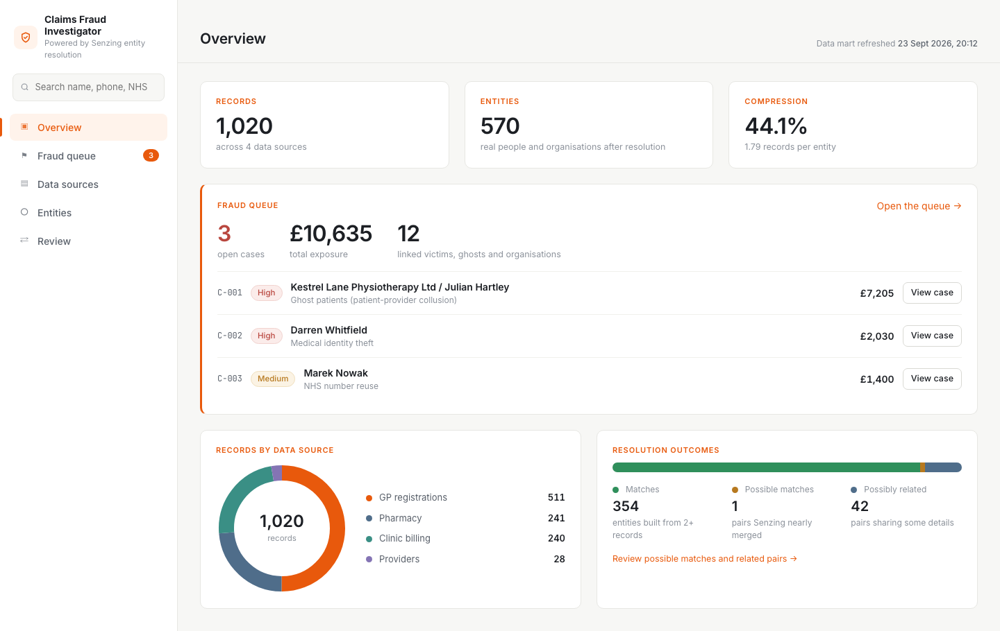

# Patient Fraud Detection in UK Private Healthcare

**What you'll build:** a fraud investigation app - your sources resolved into who is really who, the
fraud patterns you describe in plain English found in them, and an investigator's queue with the
evidence behind every suspect. In this case four healthcare sources (GP registrations, pharmacy
dispensing, private clinic billing and the clinics themselves) hiding medical identity theft, ghost
patients and a reused NHS number, among plenty of innocent lookalikes that should not be flagged.

**What it takes:** Intermediate · ~45 min once you're set up · runs on your machine · four CSVs to download and attach



*1,020 records from four sources become **570** people and organisations, and **three fraud cases** worth **£10,635** land in the investigator's queue: ghost patients, medical identity theft and NHS number reuse.*

## Chef's Note

Healthcare fraud rarely announces itself in one system. A stolen identity looks perfectly normal on
a single clinic claim: right name, right date of birth, right NHS number. What gives it away is
context from somewhere else. The patient's GP has a different address and phone on file, and those
contact details belong to someone else entirely. A ghost patient looks like any other patient on a
clinic invoice; what gives it away is that they exist nowhere else, and their "home address" is the
clinic director's house.

That's why this recipe leans on entity resolution first and fraud rules second. Senzing works out
who is who across all four sources, including the people who are **not** the same but share
details they shouldn't. Then your assistant turns a plain-English description of three fraud
patterns into detection logic, without you writing a rule.

A few things worth calling out. First, the four files **don't share field names** - the GP list has
`forename` and `surname`, the pharmacy has `first_name` and `nhs_no`, clinic billing prefixes
everything with `patient_`, and the providers file mixes clinics and clinicians in one table. Mapping
all of it to the Senzing spec is part of the recipe, and the MCP's `mapping_workflow` handles it.
Second, the trust model matters: a GP registration is the closest thing to "this is really who you
are", while pharmacy and clinic records are where an identity gets *used*. The detection prompt tells
the assistant that, and it's what separates a thief from a patient who has moved house. Third, the
data is full of innocent lookalikes on purpose (families sharing an address, people who moved,
nicknames), so a good result flags only the real fraud.

## Setup: What you'll need

- **Setup (one-time):** an AI coding assistant, the **Senzing MCP**, and your **Senzing license** - new to this? Start with **[Get Started](../getting-started.md)**.
- **Where it runs:** the prompts stand Senzing up on your own machine. Edit them if you want it somewhere else.
- **Attach your Senzing license file to the chat now** (or drop it in your assistant's working folder). The data is about 1,000 records, over the built-in 500-record evaluation limit.
- **Ingredients:** four synthetic source files in [`ingredients/patientfraud/`](../ingredients/patientfraud/) - download all four, then **attach them to the chat now** (or drop them in your assistant's working folder):
  - **GP_REGISTRATIONS** - `gp_registrations.csv`, 511 NHS GP practice registrations.
  - **PHARMACY** - `pharmacy.csv`, 241 community pharmacy dispensing records.
  - **CLINIC_BILLING** - `clinic_billing.csv`, 240 private clinic claims billed to an insurer.
  - **PROVIDERS** - `providers.csv`, 28 private clinics, their directors and other clinicians.

## Before you begin

- **Use your most capable model** (e.g. Opus for Claude), not a fast or cheap one - these recipes do real, multi-step work.
- **Yours will look different.** Your assistant builds the result fresh each run, so the layout and features vary - a chart or the graph may sit on a different page. The screenshot shows the idea, not an exact target.
- **On a Mac, expect Java.** The Senzing Python SDK is Linux-only, so on macOS your assistant will usually build the loader and app in Java. That's fine; the results are the same.
- **All data is synthetic.** NHS numbers use the 999 test prefix, phone numbers come from Ofcom's drama ranges, and every person, clinic and bank account is invented.
- **If something looks wrong, ask the assistant before starting over.** It built this and can inspect it. Say what you expected and what you got - "the fraud queue is empty, check whether the clinic billing records actually loaded" - and tell it to verify against Senzing rather than guess. Paste any error in full.

## Cook: Load the data and find the fraud

**Three prompts.** Stand up a local Senzing instance, map and load all four sources so Senzing
resolves everyone in one pass, then tell your assistant what fraud looks like and let it find it.

**Paste this into your AI assistant:**

```
Goal: Stand up a local Senzing instance, ready to load data.

Hard rules:
- Use the Senzing MCP. Do not rely on general training.
- I have provided the Senzing license file: it is attached to this chat, or in your working folder. Do not guess a path - ask me if you can't find it.
- Deploy Senzing locally using the license file I provided; a local SQLite/in-memory datastore is fine for a POC.
- Confirm the instance is up and ready before finishing.
```

**Expected outcome:** a local Senzing instance, ready to load data into SQLite.

Now the four sources. They're raw exports with their own field names, so **mapping is part of this
step** - let the MCP do it. Load them all together so Senzing resolves everyone across every source
at once.

**Then paste this:**

```
Goal: Using the existing local Senzing instance, map, load and resolve all four healthcare data sources together.

Hard rules:
- Use the Senzing MCP. Do not rely on general training.
- These files are synthetic test data (no real people), so you may read and validate them.
- Map each source with the Senzing MCP mapping_workflow - do not hand-code the Senzing JSON.
- Map only the fields you need.
- Build the loader with the Senzing MCP sdk_guide.
- Register the data sources as GP_REGISTRATIONS, PHARMACY, CLINIC_BILLING and PROVIDERS.
- Use multithreading for loading. Load every record, then process all redo records.
- Do not use sleep/wakeups.
- I have provided the source files: gp_registrations.csv, pharmacy.csv, clinic_billing.csv and providers.csv are attached to this chat, or in your working folder. Do not guess a path - ask me if you can't find them.

Preferences:
- Provide me live status updates on the data ingestion.

Steps:
1. Map, register and load all four files. Note that providers.csv holds both clinics (organisations) and clinicians (people); provider_type says which.
2. When complete, give me a short load summary: records loaded per source, resolved entities, and relationships found.
```

**Expected outcome:** 1,020 records load with no errors and resolve into roughly 570 entities. Most
patients appear in two or three sources, joined despite nicknames, typos, different date formats
and old addresses.

This is where you tell your assistant what fraud looks like. It has never seen this data, so the
prompt carries the whole briefing: what each source is, how far to trust it, the three fraud
patterns, and the innocent explanations not to flag.

**Then paste this:**

```
Goal: Using the resolved data in the existing Senzing instance, detect patient fraud and write a fraud detection report.

Background:
- I work with a UK private health insurer, looking for patient fraud across London. The people are patients and healthcare providers; providers include clinics (organisations) and the doctors who run them.
- GP_REGISTRATIONS is the most trusted source. If someone is registered with a GP they are a real person, and the address and phone on their GP record are genuinely theirs.
- PHARMACY and CLINIC_BILLING are where someone's identity gets used to obtain treatment, drugs or money. Clinic billing has one record per claim, with the clinic, treatment and amount, and sometimes a bank account for refunds.
- PROVIDERS holds the private clinics (company number, business address, phone, business bank account), their directors (GMC number, home address, personal mobile, personal bank account) and other clinicians.

What we believe fraud looks like:
1. Medical identity theft: a fraudster uses a real patient's name, date of birth and NHS number to get private treatment or prescriptions, but gives their own address, phone or email so the correspondence comes to them. The victim's genuine GP record still shows the victim's own contact details. The fraudster is usually a real, registered person in their own right, and often targets several victims, frequently elderly ones.
2. Patient-provider collusion (ghost patients): a clinic bills for patients who don't really exist. These patients have no GP registration or pharmacy history anywhere, appear only in that one clinic's billing, and reuse the clinic director's home address, personal mobile or personal bank account.
3. NHS number reuse: one NHS number used by two clearly different people (different name, date of birth or gender).

Innocent explanations not to flag: families living together, people who have moved, and carers or care homes that legitimately share contact details.

Hard rules:
- Keep all previous Hard Rules in force.
- Use the Senzing MCP, not general training.
- Base the detection on Senzing's resolved entities and relationships, using the record-level data where needed. Never query Senzing's internal engine tables directly.
- Every suspect must come with evidence: the records, the shared details and the Senzing relationship behind it.

Steps:
1. For each fraud pattern, design a detection approach and explain it in plain language.
2. Run it against the full repository and review every hit for the innocent explanations above.
3. Write a fraud detection report: for each pattern, the suspects, their victims or ghost patients, the records involved, the details they share, the £ amounts, and a one-line reason each suspect was flagged. Include what you reviewed and cleared, and why.
```

**Expected outcome:** a fraud detection report naming a small number of suspects, each with evidence.
You should see an identity thief whose contact details sit on two pensioners' clinic claims and
controlled-drug pickups, a clinic director surrounded by patients who exist only on his clinic's
invoices, and a patient billed under someone else's NHS number. The report should also list what it
cleared: house moves, households and similar lookalikes.

## Plate: Visualize the results

**One prompt.** Serve the results as an investigator's workbench: explore how the sources resolved,
then work the fraud queue.

**Paste this into your AI assistant:**

```
Goal: Build a fraud investigation web app on the resolved data in the existing Senzing instance, combining resolution exploration with a fraud investigator's queue.

Hard rules:
- Keep all previous Hard Rules in force.
- Use the Senzing MCP, not general training.
- Follow the Senzing MCP reporting_guide for every query, entity view, dashboard, and graph pattern.
- Build the reporting_guide's data mart for the exploration pages. Query Senzing directly (get entity, why, how, find network) for the fraud case details.
- Populate the app only from the data mart, the fraud detection report, and the Senzing SDK. Never query Senzing's internal engine tables directly.
- Only render the network graph for a selected case or entity, never the full graph.
- Route every entry point (queue, reports, graph, search) to one shared entity detail screen.
- Confirm the app responds before finishing.

Preferences:
- Look and feel: a clean, modern light theme in the style of today's SaaS admin dashboards. Off-white page background, white cards with thin light-grey borders and rounded corners, dark text for headings with softer grey body text, and plenty of whitespace. One warm accent colour (such as orange) for the active menu item, section labels, links and focus; green only for resolved or matched states, and a muted red and amber for severity. A clean sans-serif (such as Roboto or Inter) for text and a monospace face for record IDs and match keys. No gradients, no heavy shadows.
- Layout: a left sidebar menu with the app name at the top, a search box, then Overview, Fraud queue (with a count of open cases), Data sources, Entities and Review. The active item gets a pale tint of the accent colour with an accent bar on its left edge. Page content sits to the right with a simple top bar showing the page title and when the data mart was last refreshed.
- Overview (the landing page): big-number tiles for records, entities and compression; a donut chart of records by data source with counts; a bar showing matches, possible matches and possibly related; and a prominent fraud queue summary (open cases, total £ exposure, and the top cases, each linking straight to its case view). Small uppercase section labels in the accent colour, with a little letter-spacing.
- Fraud queue: one row per suspect from the fraud detection report, showing the fraud pattern, severity, £ exposure and number of linked entities, plus overall totals and what was reviewed and cleared.
- Case view: why the suspect was flagged, the innocent explanation to rule out, and the people and organisations involved.
- Network graph for each case: the suspect and everyone Senzing links to them. Lines are Senzing relationships only, labelled with their match key. Use a force-directed layout that spreads the nodes out, with the suspect in the centre, labels that don't overlap nodes, lines or each other, and nodes you can drag. Colour nodes by their role in the case.
- Why: clicking a line shows why Senzing related the two entities, as a side-by-side feature comparison with scores.
- Entity detail: the entity's records with the details the case turns on highlighted, and how Senzing built the entity from those records (the Senzing HOW report).
- Data sources page from the data mart: records, entities and matches within each source, and the overlap between each pair of sources, with drill-down from any number to the match keys behind it and then the entities.
- Entities page: entity size and relationship breakdowns, also with drill-down to the entities.
- Review page: Senzing's possible matches and possibly related pairs, each opening the why comparison.
- Search by name, address, phone, email or NHS number.

Steps:
1. Build the data mart and the web app.
2. Wire the fraud queue to the fraud detection report and the case views to live Senzing queries.
3. Give me the local URL.
```

**Expected outcome:** a local URL that opens on a light overview page with the headline numbers and
the fraud queue front and centre. Open the identity theft case and the graph shows the suspect linked
to both victims; click a line and the side-by-side comparison shows name, date of birth and NHS number
disagreeing while address, phone and email match exactly. Open a victim and the HOW steps show the
fraudulent claims joining her record on her own name, date of birth and NHS number, bringing someone
else's contact details with them. The data sources page shows how the four sources overlap, and every
number drills down to real entities.

## Plus: Add additional data

**One prompt.** Fraud doesn't wait for the next batch load. Add a single new clinic claim that reuses
the identity thief's contact details under another patient's identity, and watch Senzing resolve it
in place and the fraud queue pick it up, with no reload.

**Paste this into your AI assistant:**

```
Goal: Add one new clinic claim to the existing Senzing instance and show the fraud queue picking it up without a full reload.

Hard rules:
- Keep all previous Hard Rules in force.
- Use the Senzing MCP, not general training.
- Map the new claim exactly the way clinic_billing.csv was mapped, as data source CLINIC_BILLING with a new record ID.
- Add the one record through the Senzing SDK and process any redo records. Do not reload or purge anything.

Steps:
1. Pick a GP-registered patient who is not already in any fraud case. Create one new clinic claim using that patient's name, date of birth and NHS number, but the medical identity theft suspect's address and phone.
2. Add it to Senzing and show me which entity it resolved into and why.
3. Re-run the fraud detection for the affected entities only, update the fraud detection report, and refresh the app.
4. Tell me what changed in the fraud queue.
```

**Expected outcome:** the new claim joins the real patient's entity on name, date of birth and NHS
number, and Senzing relates it to the suspect through the shared address and phone. The identity
theft case in the queue now lists a third victim, with the extra £ exposure, and the case graph shows
the new link. You can also tune the detection itself the same way: change the plain-English fraud
description (for example, "flag any contact detail shared by three or more unrelated patients") and
rerun the detection prompt. No code changes, just a different briefing.

## Wrap Up

In ~45 minutes you built a **patient fraud investigation app**: four mismatched healthcare sources
mapped and resolved into one view of who is who, three fraud patterns detected from a plain-English
briefing, and an investigator's queue with the evidence behind every suspect. Swap in your own sources
and your own description of fraud (mind the PII) and the same moves - cook, plate, add - carry over.

To show it to someone, about ten minutes covers it:

1. **The problem.** A stolen identity looks normal on a single claim. What gives it away is context
   from another system, and that's an entity resolution problem before it's a fraud rules problem.
2. **The brief.** Show the detection prompt: four sources, which one to trust, three fraud patterns
   and the innocent lookalikes, all in plain English. No rules written by hand.
3. **The overview and queue.** Around 1,000 records resolve into about 570 real people and
   organisations. Point at the open cases, then at what was reviewed and cleared: flagging only the
   right people is what makes investigators trust the queue.
4. **Identity theft.** Open the case, then the line between the suspect and a victim: name, date of
   birth and NHS number disagree, while address, phone and email match. Open the victim and show the
   HOW steps: the fraudulent claims joined her on her own identity, bringing someone else's contact
   details with them.
5. **Ghost patients.** Open the case and let the graph speak: the director in the middle, patients
   who exist only on his clinic's invoices around him, each tied to his home, phone or bank account.
6. **NHS number reuse.** Senzing kept two clearly different people apart despite a shared identifier,
   and flagged the identifier for review.

**Next:** browse [the cookbook](../cookbook.md) for another use case.
